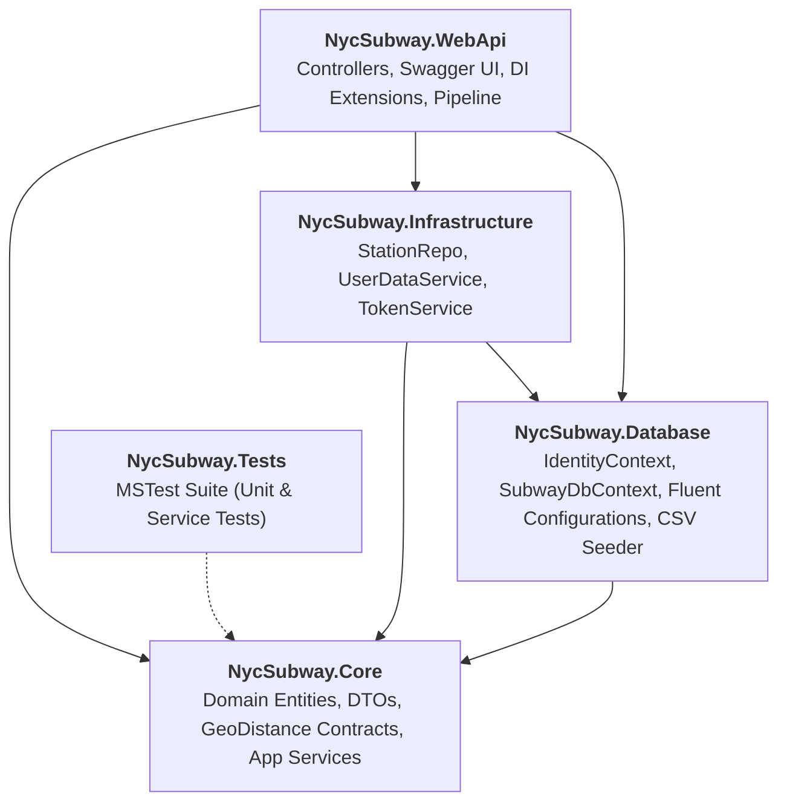

# NYC Subway API

[](https://dotnet.microsoft.com/)
[](https://docs.microsoft.com/en-us/dotnet/csharp/)
[](https://learn.microsoft.com/en-us/dotnet/core/testing/unit-testing-with-mstest)
[](https://swagger.io/)
[](https://learn.microsoft.com/en-us/ef/core/)

A production-ready RESTful API built with **ASP.NET Core (.NET 8)** adhering to **Clean Architecture** principles. The application provides geospatial querying of NYC Subway entrances, calculates great-circle distances using the Haversine formula, and allows authenticated users to bookmark frequently used subway stations.

---

## Architecture Overview

The solution is structured around the principles of **Clean Architecture** and **Domain-Driven Design (DDD)** to enforce loose coupling, high cohesion, and testability:



### Layer Responsibilities

* **`NycSubway.Core`** (Domain & Application Core)
  * **Domain Entities**: [`AppUser`](NycSubway.Core/Entities/AppUser.cs), [`StationEntrance`](NycSubway.Core/Entities/StationEntrance.cs), [`AppUserStationEntrance`](NycSubway.Core/Entities/AppUserStationEntrance.cs).
  * **Geospatial Domain**: [`IGeoCalculator`](NycSubway.Core/Services/GeoDistance/GeoCalculator.cs) contract and [`HaversineGeoCalculator`](NycSubway.Core/Services/GeoDistance/GeoCalculator.cs) implementation with numerical clamping to guarantee zero `NaN` occurrences.
  * **Application Interfaces**: [`IStationService`](NycSubway.Core/Services/Station/StationService.cs), [`IStationRepo`](NycSubway.Core/Services/Station/IStationRepo.cs), [`IUserDataService`](NycSubway.Core/Services/User/IUserDataService.cs), [`ITokenService`](NycSubway.Core/Services/Identity/ITokenService.cs).
  * **DTOs & Models**: [`StationEntranceModel`](NycSubway.Core/Services/Station/StationEntranceModel.cs), [`GeoPoint`](NycSubway.Core/Services/Station/GeoPoint.cs), [`UserData`](NycSubway.Core/Models/UserData.cs), [`ResultResponse`](NycSubway.Core/Models/ResultResponse.cs).
* **`NycSubway.Database`** (Persistence Layer)
  * **Bounded Contexts**: Independent `IdentityContext` (Security/Auth) and `SubwayDbContext` (Core Transit Domain).
  * **Fluent Configurations**: Entity property definitions, keys, and non-clustered indexes.
  * **Seed Data**: Automatically imports NYC DOITT subway entrance geospatial data and pre-provisions a default test account.
* **`NycSubway.Infrastructure`** (Adapters)
  * Implements [`StationRepo`](NycSubway.Infrastructure/Repositories/StationRepo.cs) querying EF Core with non-tracking queries.
  * Implements [`UserDataService`](NycSubway.Infrastructure/Services/UserDataService.cs) with duplicate protection and safe lookups.
  * Implements [`TokenService`](NycSubway.Infrastructure/Identity/TokenService.cs) generating JWT tokens with HMAC-SHA512.
* **`NycSubway.WebApi`** (Presentation)
  * REST controllers with comprehensive Swagger / OpenAPI documentation.
  * JWT Bearer token authentication middleware.
  * Zero-config SQLite initialization and structured migration logging.
* **`NycSubway.Tests`** (Automated Testing)
  * Comprehensive unit tests using official Microsoft **MSTest**.

---

## Architectural Decision Records (ADRs)

### 1. Dual DbContexts for Bounded Contexts (SRP)
Instead of forcing Microsoft Identity tables (`AspNetUsers`, `AspNetUserRoles`, etc.) into the same database schema as transit stations, the application maintains two distinct DbContexts:
* **`IdentityContext`**: Manages credentials, password hashes, and security claims.
* **`SubwayDbContext`**: Manages the business domain (subway stations, entrances, user favorites).

**Why?** In enterprise architectures, identity management frequently lives in an external identity provider or dedicated security database. Decoupling them ensures authentication changes never risk altering core transit data or schema migrations.

### 2. Zero-Config Local Execution (SQLite Default)
The application defaults to **SQLite** (`"UseSqlite": true` in `appsettings.json`), allowing reviewers to clone and run the project immediately on any platform (Windows, macOS, Linux) without requiring a pre-installed SQL Server instance. SQL Server remains supported simply by setting `"UseSqlite": false`.

### 3. Lean Geo-Distance Architecture
Calculations are encapsulated behind the [`IGeoCalculator`](NycSubway.Core/Services/GeoDistance/GeoCalculator.cs) domain service. By implementing the **Haversine formula** directly with `Math.Clamp`, the code eliminates unnecessary wrapper classes, prevents floating-point `NaN` edge cases, and allows the calculation strategy to be swapped in DI without modifying callers.

---

## Quick Start

### Prerequisites
- [.NET 8.0 SDK](https://dotnet.microsoft.com/download/dotnet/8.0)

### 1. Clone & Run Tests
```bash
git clone https://github.com/ctorrez/NycSubway.git
cd NycSubway
dotnet test
```

### 2. Run the Web API
```bash
dotnet run --project NycSubway.WebApi
```
On initial launch, SQLite database files (`NycSubwayAuth.db` and `NycSubwayDb.db`) are created and seeded automatically with:
- Pre-seeded test user account.
- 1,900+ NYC Subway station entrances from the official NYC DOITT geospatial dataset.

### 3. Open Swagger UI
Navigate to:
- **`https://localhost:5001/swagger`** (or `http://localhost:5000/swagger`)

---

## API Endpoints & Authentication

### Pre-Seeded Test Credentials
To test authorized endpoints, use the pre-seeded account:
* **Email / Username**: `ctorrez@test.com` / `ctorrez`
* **Password**: `Challenge#2022`

### Endpoints Summary

| Method | Endpoint | Auth | Description |
| :--- | :--- | :---: | :--- |
| `POST` | `/api/account/login` | No | Authenticate user and obtain a JWT Bearer token |
| `GET` | `/station/station-entrances` | No | Retrieve all NYC subway station entrances |
| `POST` | `/station/station-distance` | No | Calculate the great-circle distance between two stations |
| `GET` | `/api/user/stations` | **JWT** | Get the authenticated user's saved stations |
| `POST` | `/api/user/save-station` | **JWT** | Bookmark a station entrance for the authenticated user |

### Sample: Calculate Station Distance
**Request:**
```http
POST /station/station-distance HTTP/1.1
Content-Type: application/json

{
  "entrance1": {
    "name": "Grand Central - 42 St",
    "point": { "latitude": 40.7527, "longitude": -73.9772 }
  },
  "entrance2": {
    "name": "Times Sq - 42 St",
    "point": { "latitude": 40.7557, "longitude": -73.9870 }
  }
}
```

**Response (`200 OK`):**
```json
{
  "unit": "Miles",
  "value": 0.5518
}
```

---

## Running with Docker

Build and run the containerized API using .NET 8 multi-stage build:

```bash
docker build -f NycSubway.WebApi/Dockerfile -t nycsubway-api .
docker run -d -p 8080:8080 --name nycsubway nycsubway-api
```
Navigate to `http://localhost:8080/swagger` to access the API.

---

## Running Tests

Unit tests are written with official Microsoft **MSTest**:

```bash
dotnet test
```

Test coverage includes:
* **Distance Calculation**: Verified against real NYC subway coordinates (Grand Central 42 St to Times Sq 42 St ~0.55 mi).
* **Boundary & Numerical Stability**: Identical coordinate pairs guaranteed to return `0.0` without `NaN`.
* **Unit Conversions**: Miles, Kilometers, Nautical Miles.
* **Service Delegation**: Asynchronous station queries and null-safe coordinate handling.

---

## License
This project is licensed under the MIT License.
