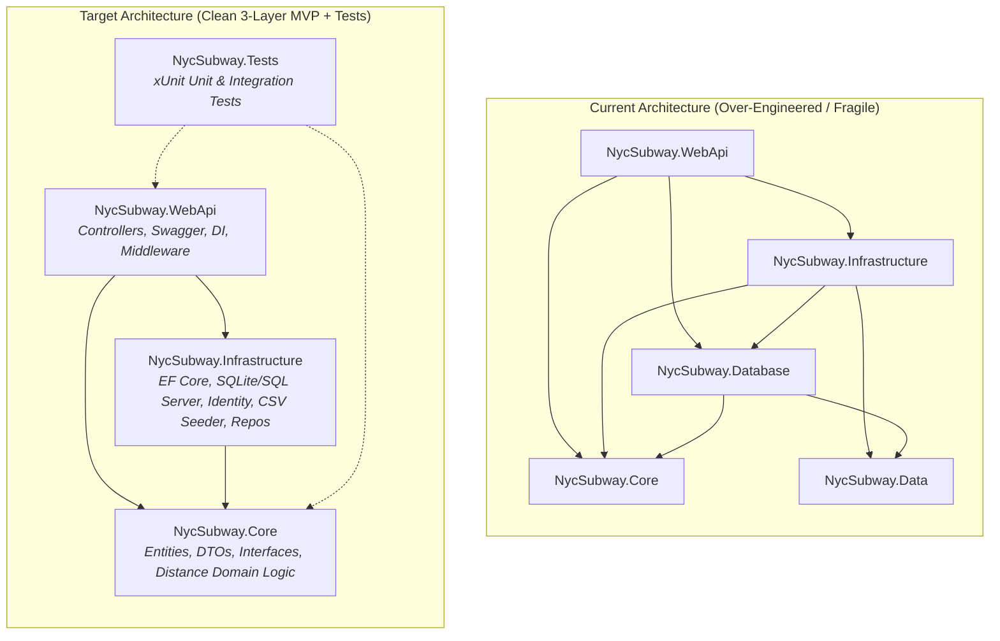

# Implementation Plan: NYC Subway API - Minimal MVP & Clean Architecture

## 1. Executive Summary

This plan outlines the step-by-step refactoring of the **NYC Subway API** to transform it from a job application take-home assignment into a production-grade, highly polished portfolio project on GitHub.

### Primary Objectives
- **Zero-Friction First Impression**: Fix build breakages and database dependencies so any hiring manager or recruiter can clone and run the API with a single command (`dotnet run`) on any OS (Windows/macOS/Linux).
- **Core Domain Accuracy**: Correct the critical coordinate inversion bug in WKT parsing (`POINT(long lat)`) that distorts all geo-distance calculations.
- **True Clean Architecture (Minimal MVP)**: Streamline the solution from 5 over-fragmented projects down to 3 cohesive layers (`Core`, `Infrastructure`, `WebApi`) plus a test suite.
- **Modernization & Verification**: Upgrade to .NET 8 (LTS), eliminate dead code, add automated tests, and provide a comprehensive README.

---

## 2. Current State vs. Target State

### Gap Analysis

| Area | Current State | Target MVP State |
| :--- | :--- | :--- |
| **Build Status** | Fails on any fresh machine due to hardcoded path: `C:\Users\PC\...` | Portable `<GenerateDocumentationFile>true</GenerateDocumentationFile>` |
| **Framework** | .NET Core 3.1 (EOL since Dec 2022) | **.NET 8 LTS** |
| **Geo Calculation** | Longitude and Latitude inverted in CSV parsing; distances inaccurate | Parsed correctly as `X=Longitude, Y=Latitude` with `CultureInfo.InvariantCulture` |
| **Database** | 2 separate SQL Server Express databases (`localhost\SQLExpress`) | Single unified DbContext with **SQLite default** (zero-config) + SQL Server option |
| **Data Flow** | CSV read and parsed from disk on **every** HTTP request in `StationRepo` | CSV seeded once on startup; API queries EF Core with async queries |
| **Project Structure** | 5 projects (`Core`, `Data`, `Database`, `Infrastructure`, `WebApi`) | 3 projects (`Core`, `Infrastructure`, `WebApi`) + 1 Test project |
| **Tests** | Zero tests | Comprehensive unit tests for geo-math & integration tests for endpoints |
| **Code Hygiene** | Unused template code (`WeatherForecast*`, `ContactOperations.cs`, empty folders) | Clean, production-focused codebase |
| **Documentation** | 3-line README with no instructions or credentials | Full README with architecture diagram, quick start, sample cURL, and test credentials |

---

## 3. Phased Implementation Roadmap

### Phase 1: Critical Bug Fixes & Code Cleanup (Completed)

- [x] **Fix Build Breakage**:
  - In `NycSubway.WebApi/NycSubway.WebApi.csproj`, replaced hardcoded path with `<GenerateDocumentationFile>true</GenerateDocumentationFile>` and `<NoWarn>$(NoWarn);1591</NoWarn>`.
- [x] **Fix Inverted Coordinates Bug**:
  - In `SubwayData.cs` and `StationRepo.cs`, corrected WKT parsing so `values[1]` maps to Longitude and `values[2]` maps to Latitude with `CultureInfo.InvariantCulture`.
- [x] **Remove Dead Code & Template Files**:
  - Deleted `WeatherForecastController.cs`, `WeatherForecast.cs`, and `ContactOperations.cs`.
  - Removed empty folders (`NycSubway.Core/Interfaces/`, `NycSubway.WebApi/Interfaces/`, `NycSubway.WebApi/Services/`).
- [x] **Fix Database Migration in `Program.cs`**:
  - Added `await subwayContext.Database.MigrateAsync();` alongside Identity migration before seeding.

---

### Phase 2: Modernization (.NET 8) & Zero-Friction Database (Completed)

- [x] **Upgrade Target Framework**:
  - Upgraded all `.csproj` files to `<TargetFramework>net8.0</TargetFramework>`.
  - Updated NuGet dependencies to modern .NET 8 versions (`Microsoft.EntityFrameworkCore` 8.0.10, `Microsoft.AspNetCore.Authentication.JwtBearer` 8.0.10, `Swashbuckle.AspNetCore` 6.6.2, `CsvHelper` 33.0.1, `System.IdentityModel.Tokens.Jwt` 8.0.1).
- [x] **Implement Frictionless Local Database (SQLite by default)**:
  - Added SQLite provider support via `"UseSqlite": true` in `appsettings.json`.
  - Configured provider-aware initialization in `Program.cs` (`EnsureCreatedAsync` for SQLite, `MigrateAsync` for SQL Server) with error handling.
  - Verified runtime launch, automatic DB creation, and successful seeding.
  - Added SQLite patterns (`*.db`, `*.db-wal`, `*.db-shm`) to `.gitignore`.
- [x] **Fix `Dockerfile`**:
  - Updated base images to `aspnet:8.0` and `sdk:8.0`.
  - Updated restore step to copy all referenced project files for reliable container builds.

---

### Phase 3: Architectural Simplification (Minimal MVP) (Completed)

- [x] **Consolidate Domain Entities into `Core`**:
  - Moved `AppUser`, `StationEntrance`, and `AppUserStationEntrance` into `NycSubway.Core/Entities/`.
  - Removed redundant `NycSubway.Data` project from solution and disk.
- [x] **Keep `NycSubway.Database` with Bounded Contexts (ADR Decision)**:
  - Preserved separate `IdentityContext` and `SubwayDbContext` for Single Responsibility Principle (SRP) and domain boundary isolation.
  - Kept EF Core migrations, configurations, and CSV seeder isolated in `NycSubway.Database`.
- [x] **Unify Station Data Flow & Deduplicate Seed Data**:
  - Refactored `StationRepo` in `Infrastructure` to query `SubwayDbContext` using EF Core `AsNoTracking().ToListAsync()`.
  - Removed per-request CSV parsing from `StationRepo`.
  - Removed duplicate CSV file from `Infrastructure/SeedData/` and removed unused `CsvHelper` dependency from Infrastructure.
- [x] **Make Async the Default & Dependency Abstraction**:
  - Converted `IStationRepo`, `IStationService`, `StationService`, and `IUserDataService` to `async`/`await`.
  - Registered and injected `IStationService` in `StationController`.
- [x] **Input Validation & Safe Lookups**:
  - Added null and empty checks for entrance coordinates in `StationController`.
  - Updated `SaveStationEntranceAsync` to safely check for existing entrance, handle not found, and prevent duplicate bookmarks.

---

### Phase 4: Automated Testing Suite (Completed)

- [x] **Create Test Project `NycSubway.Tests`**:
  - Created official Microsoft MSTest project targeting `.NET 8`.
  - Added reference to `NycSubway.Core` and added to `NycSubway.sln`.
- [x] **Lean Geo-Distance Architecture**:
  - Implemented `IGeoCalculator` and `HaversineGeoCalculator` directly in Core.
  - Eliminated redundant `Coordinates.cs` and `CoordinatesDistanceExtensions.cs` to keep the codebase lean and free of middle-man boilerplate.
  - Fixed floating-point `NaN` edge cases with `Math.Clamp`.
- [x] **MSTest Unit Test Suite (11/11 Passing)**:
  - `GeoCalculatorTests`: Verified identical point calculation returns `0.0` without `NaN`.
  - Tested real NYC subway station distance: Grand Central 42 St to Times Sq 42 St (~0.55 miles).
  - Tested unit conversion between Miles and Kilometers.
  - Tested null coordinate handling.
  - `UnitOfLengthTests`: Tested conversion factors for Kilometers, Miles, and Nautical Miles.
  - `StationServiceTests`: Tested service delegation with fake repository and null entrance handling.

---

### Phase 5: GitHub Portfolio Polish (README & Presentation) (Completed)

- [x] **Create a Professional `README.md`**:
  - **Badges**: .NET 8 LTS, C# 12, MSTest, Swagger/OpenAPI, SQLite.
  - **Overview**: NYC Subway API query engine, great-circle distance calculator, and user bookmarking.
  - **Architecture Diagram**: Clean Mermaid diagram explaining the 4-layer structure.
  - **Architecture Decision Records (ADRs)**: Documented rationale for dual DbContexts (Bounded Contexts & SRP), zero-config SQLite, and lean Haversine calculator.
  - **Quick Start Guide**: Step-by-step instructions for `dotnet test` and `dotnet run`.
  - **API Documentation & Pre-Seeded Credentials**: Listed test credentials (`ctorrez` / `Challenge#2022`) and sample request/response payloads.
  - **Docker & Testing**: Container build instructions and test coverage summary.
